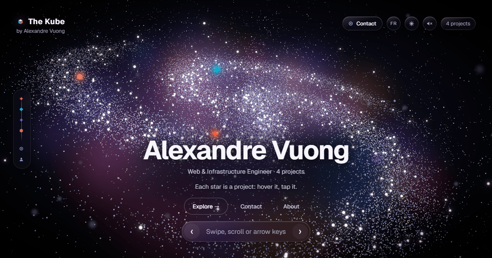
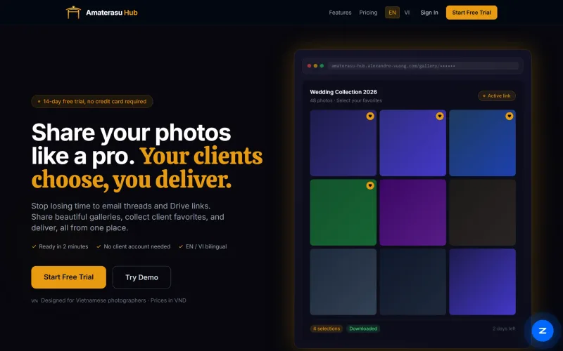
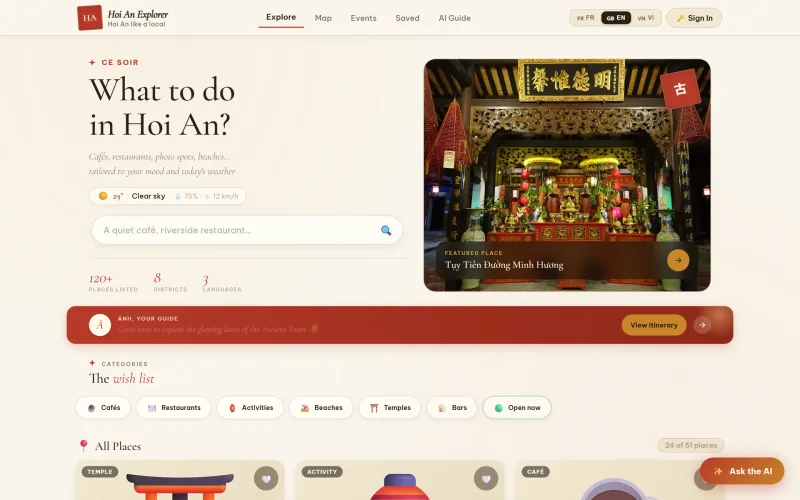
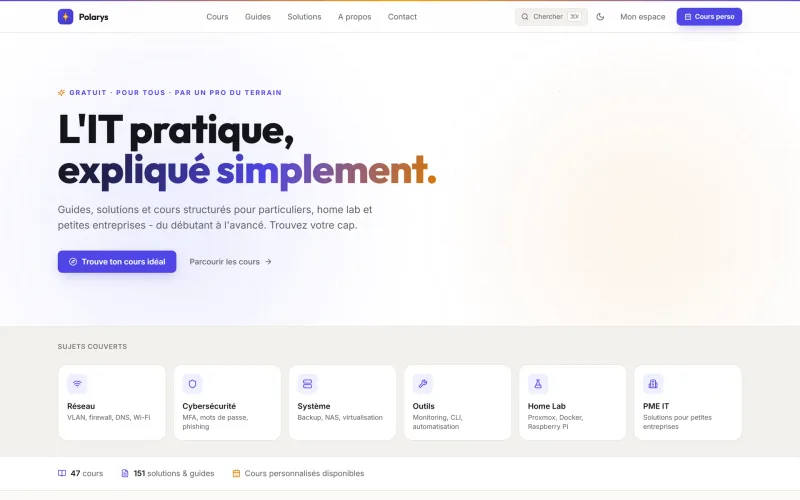
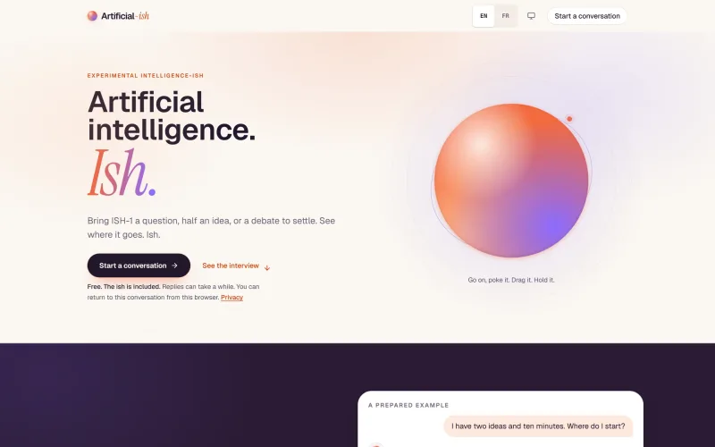

### Alexandre Vuong — Web & Infrastructure Engineer

French-Vietnamese. I design, build and deploy complete web applications on my own, from mockup to production. On the infrastructure side: system and network administration, containerized services and high availability, with cybersecurity as a common thread.

**Portfolio → [alexandre-vuong.com](https://alexandre-vuong.com)** — a WebGL particle nebula where each project takes shape.

#### Live projects

<table>
  <tr>
    <td width="50%" valign="top">
      
       <b><a href="https://amaterasu-hub.alexandre-vuong.com">Amaterasu Hub</a></b>
       Pro photo galleries for studios & photographers: secure links, client favorites, HD delivery.
    </td>
    <td width="50%" valign="top">
      
       <b><a href="https://hoian-explorer.web.app">Hoi An Explorer</a></b>
       Smart local guide for Hoi An: AI assistant, weather-aware picks, map & itinerary.
    </td>
  </tr>
  <tr>
    <td width="50%" valign="top">
      
       <b><a href="https://polarys.alexandre-vuong.com">Polarys</a></b>
       IT made simple, in practice: free step-by-step guides, no jargon.
    </td>
    <td width="50%" valign="top">
      
       <b><a href="https://artificial-ish.alexandre-vuong.com">Artificial-ish</a></b>
       Experimental conversational app. Artificial intelligence. <i>Ish.</i>
    </td>
  </tr>
</table>

#### Stack

<b>Web</b>&nbsp;      

<b>Infra & security</b>&nbsp;     

#### Contact

  

